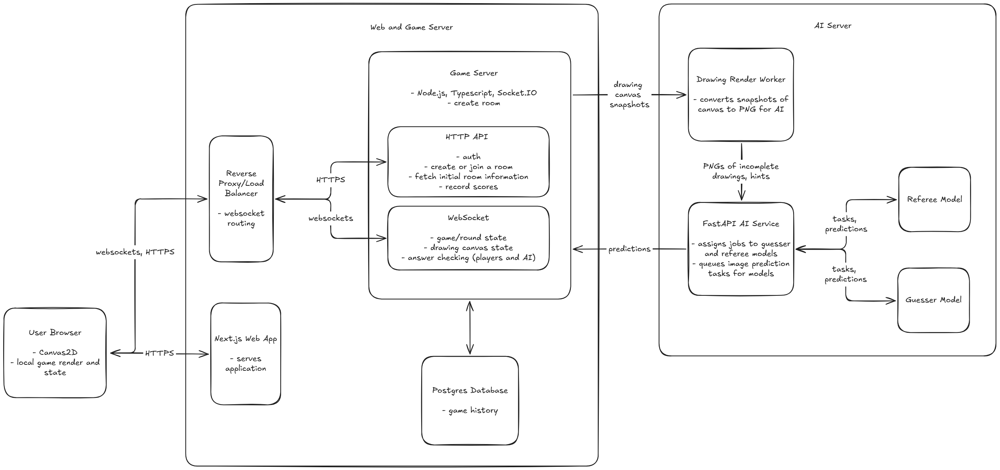

# Get the Picture? — System Design

Consolidated on **31 October 2026 (Asia/Manila)**. Game name: **Get the Picture?**.

This is the self-contained record of the game and system-design decisions agreed in today's conversation, including the final clarification session. It is the current design reference when an older handoff, README, glossary entry or diagram differs.

**Status:** the architecture and behavioral policies below are the agreed design baseline. Module names, internal route names, exact tuning values, model suitability and deployment capacity are not validated implementation results. No application, infrastructure or model benchmark has been produced by this documentation work.

## Decision status and precedence

- **Confirmed:** flexible team composition, the drawing/guessing/scoring rules, Next.js web application, NestJS + Socket.IO game backend, FastAPI inference boundary, active match state in RAM, PostgreSQL persistence, and the failure policies recorded here.
- **Explicitly excluded:** Redis and the earlier distributed journal/lease/failover design. One active game process is the baseline.
- **Working implementation recommendations:** TypeScript, Tailwind CSS, shadcn/ui, Prisma, Pydantic, PyTorch/Transformers, worker isolation, stable event/job identities, bounded queues and versioned model inputs. The detailed responsibilities are included below; these do not imply packages are installed.
- **Candidates or optional:** Qwen and Florence model selections, Langfuse, frontend authoring tools and physical hosting choices.
- **Deferred:** exact score weights, timing/limits, answer aliases, ties, model/runtime tuning and the detailed study protocol. These stay explicit rather than becoming accidental defaults.

Latest explicit user decisions take precedence over older alternatives. In particular, the game uses teams rather than fixed pairs, match length need not be even, and live event acceptance no longer waits for an external recovery-journal write.

## Agreed game contract

The project is a skribbl.io-inspired multiplayer drawing game for an intelligent-systems class, using transformer-powered guessing and advisory refereeing.

| Topic | Agreed behavior |
| --- | --- |
| Teams | Players agree on the number of teams and the number of players per team. At least two teams compete; a team starts with at least two human players for drawing and guessing. Equal sizes are not required. |
| Valid formats | Examples include `2v2`, `2v2v2`, `3v3`, `3v3v3`, `2v3` and `3v2v4`. There is no fixed gameplay maximum; practical admission capacity requires measurement. |
| Roles | Each team has one drawer per round. All its other players are human guessers. Drawer duty rotates through the team after each completed round. |
| Prompt | Every team receives the same fresh randomly selected prompt each round. Use familiar everyday drawable concepts in the style of ordinary skribbl prompts. AI familiarity is a goal to check, not proof of training exposure. |
| Private canvas | Each team has a separate canvas. Human guessers see their own team's drawing; opposing drawings and human guess text stay private during active play. |
| Public information | Opponent/team progress is visible. AI progress is visible, but actual AI guess text stays hidden until the reveal/replay. |
| Official hints | Human and AI guessers receive the same word length and progressively revealed letters on the same round schedule. |
| Human guessing | Human guesses have no fixed cap; eligible teammates can keep guessing until the team solves, forfeits or times out. |
| AI guessing | Each team's logical AI competitor gets the same guess cap and fixed checkpoint schedule. It uses only that team's canonical drawing and permitted official hints. |
| Team solve | The first correct teammate guess solves the challenge for the whole team. Award one team result, not extra solve scores for every teammate. |
| Scoring | A correct human solve earns speed-based points even if the AI answered earlier. Beating the AI adds a bonus when the team's race remains eligible. Scores and bonuses are provisional until round finalization. |
| Challenge finish | A team solve, forfeit or timeout ends that team's challenge and its drawing/AI guessing. Other teams continue. An AI solve alone does not stop human guessing for speed points. |
| Round finish | Close the round after every team has solved, forfeited or reached the common deadline. Reveal the drawings and AI attempts, and provide the replay. |
| Match finish | Players agree on a fixed round count. It need not be even or complete every team's drawing rotation. Highest finalized team score wins; exact tie rules are deferred. |
| AI difficulty | Aim for a credible, beatable competitor with uncertain race outcomes. No accuracy or balance result is established yet. |
| Drawing strategies | Any visual strategy is legal, including indirect references and private visual codes. Random prompts are not assumed to prevent prearranged codes. |
| Written clues | Written answer clues are prohibited, including spelling, initials, translations and letter-by-letter hints. Incidental writing that belongs to a depicted object is permitted. |
| Referee | A separate transformer referee publicly flags suspected written clues. Flags are advisory: no automatic punishment or required erasure. Players resolve disputes. Public warnings do not expose private opposing drawings or recognized text. |

A voided round does not count toward the agreed match length or advance drawer rotation. Retry that round position with a fresh prompt and new round generation.

### Terms used in this design

- **Team challenge:** one team's drawing and guessing competition within a round.
- **Active human guesser:** an eligible non-drawer who is connected and has completed initial/catch-up synchronization for the current challenge. A connected active guesser's checkpoint readiness is checked separately; it cannot simply be ignored because its acknowledgement is late.
- **Team solve:** the first correct accepted human guess for that team.
- **AI checkpoint:** a scheduled opportunity to submit one permitted AI attempt from a frozen drawing/hint state, within the agreed budget.
- **Provisional result:** a live result that has not yet been finalized and committed for the round.
- **Finalized result:** the round's confirmed score and eligibility outcome after its required records have saved.
- **Unavailable AI attempt:** a required attempt that could not be completed, distinguished from an incorrect answer and from normal cancellation.

## Design priorities

Responsiveness is the main operational priority. Match state must remain internally consistent even though saved views and archival work can lag behind live play. Human and AI competitors must use the permitted observations; the AI must not knowingly receive a newer drawing/hint version than active human guessers have reported rendering.

Keep ordinary drawing delivery independent of SQL reads, page rendering, image compression and GPU inference. Availability in this baseline means independent matches and sensible client reconnection while the game process runs. A restart interrupts its hosted matches; transparent server failover is outside the selected baseline.

## High-level architecture

[Editable Excalidraw source](docs/get-the-picture-system-design.excalidraw) · [PNG preview](docs/get_the_picture_system_design.png)

The browser paints immediately and sends small drawing-operation batches over a persistent Socket.IO connection to NestJS. The backend validates and serializes each match's events, updates authoritative state in RAM, and broadcasts role-filtered operations. A bounded background writer archives batches to PostgreSQL. Image rendering and GPU inference run in workers, and AI completions are pushed back to the match engine.

The baseline runs **one active NestJS game process**, which can host multiple matches. Next.js and FastAPI are separately restartable applications. A disconnected client can resynchronize while that game process survives. A game-process restart loses its active state, so unfinished rounds are voided and retried from saved match metadata and committed prior-round results. Transparent active-match failover and shared state across multiple game replicas are outside this baseline.

The retained Excalidraw diagram is a high-level architecture sketch. The precise framework choices and behavioral policies in this document take precedence over abbreviated diagram labels. Render and archive workers are responsibilities owned by the game backend; each box does not imply a separate deployed microservice.

## Current stack and ownership

| Component | Stack | Responsibility and owned state |
| --- | --- | --- |
| Browser interface | Next.js, React, TypeScript, Tailwind CSS, shadcn/ui | UI, Canvas 2D renderer, socket client and rendered-version tracking |
| Web application | Next.js App Router | Pages, guest-session interface, lobby and replay views; calls game-owned APIs |
| Game backend | NestJS on Node.js, TypeScript, Socket.IO | Authoritative rooms, teams, prompts, hints, clocks, guesses, scoring, attempts and live match state |
| Render workers | NestJS-owned worker processes/threads | Canonical drawing snapshots and image compression outside the game event loop |
| AI service | Python, FastAPI, Pydantic | Internal job contracts, bounded admission, deadlines and pushed completions |
| Inference workers | PyTorch, Hugging Face Transformers | Loaded candidate models and bounded GPU scheduling; no direct game-database access |
| Persistence and exports | NestJS services/background workers, Prisma, PostgreSQL | Saved match setup, round events, finalized scores, replay/input artifacts and authorized exports |
| Research runner | Python, pandas, Jupyter, matplotlib | Authorized matched-sketch exports and a separate sketch-focused comparison |
| Observability | Structured logs and metrics; Langfuse optional | Drawing, reconnect, archival, queue and inference timings |

NestJS is the application framework. Its Socket.IO gateway receives drawing, guess and status events; HTTP controllers expose room, session, saved replay and research-export APIs. Nest supports Socket.IO gateways and shares application facilities such as providers, guards and validation with them. See [NestJS gateways](https://docs.nestjs.com/websockets/gateways).

Keep a single application-level match registry and one deterministic engine per match. Gateways and controllers call the same engine; async handlers must enter that match's explicit serialized event queue. Framework routing alone does not serialize competing human guesses and AI results. Suggested modules are rooms/teams, match lifecycle and scoring, AI coordination, persistence, and replay/exports. These are organizational boundaries inside the backend, not new network services.

Next.js Client Components handle browser interactivity. Per-stroke Canvas updates stay in an imperative renderer while React handles lower-frequency UI state. See [Next.js Server and Client Components](https://nextjs.org/docs/app/getting-started/server-and-client-components). Keep image processing and model work away from the realtime event loop; see [Node.js event-loop guidance](https://nodejs.org/en/learn/asynchronous-work/dont-block-the-event-loop).

Stitch, v0 and Figma remain optional design-authoring choices, not runtime dependencies. No hosting vendor, GPU or production capacity is selected.

## Gameplay and live drawing path

The game supports player-agreed team counts and sizes, including unequal teams. Every round has one drawer per team and all remaining teammates guessing. All teams receive the same fresh prompt, shared hint schedule and time limit. Drawer duty rotates each round; match length is an agreed fixed count.

1. A guest joins with a stable application identity. Check room membership and role on protected events; room codes and transient socket IDs are not authorization.
2. Save match setup, team rosters, rules and rotation information. Record round-start metadata before starting the shared clock. Deliver the full target only to drawers.
3. A drawer paints locally and sends small operation batches with stable IDs. A provisional 16–33 ms batch interval is a tuning starting point, not a measured optimum.
4. The NestJS match engine checks membership, role, operation limits and ordering, then serializes the event, assigns its canonical sequence and updates RAM.
5. Confirm live acceptance and broadcast the operations immediately after that in-memory transition. Enqueue a copy for background persistence. **Live acceptance means accepted into the current process's match state, not already committed to durable storage.**
6. Human clients apply accepted operations directly to Canvas. They deduplicate retries, detect sequence gaps and reconcile local optimistic drawing with canonical state.
7. The first correct teammate answer closes the team's challenge and records one provisional score plus any eligible AI bonus. Cancel that team's drawing and further AI guessing.
8. Other teams continue until all challenges solve, forfeit or time out. Close the round and reveal/replay its recorded events. The live replay may use RAM while saving is pending. Flush the required records and finalize the result once before advancing the match and rotating drawers.

Stroke delivery does not invoke a Next.js Server Action, route render, per-stroke SQL read or full-image upload. PostgreSQL writes are batched in the background, not awaited by each stroke. Socket.IO preserves ordering but defaults to at-most-once delivery, so stable operation IDs, retry handling, gap detection and resynchronization remain application responsibilities. See [Socket.IO delivery guarantees](https://socket.io/docs/v4/delivery-guarantees/).

## Active state and persistence

| Location | Stored information | Purpose |
| --- | --- | --- |
| Browser memory | Rendered canvas, hint version and applied sequence | Painting and rendered-view acknowledgements |
| NestJS process RAM | Match registry; canonical canvas, roles, clock, hints, scores, attempts, dedupe state and recent operations | Authoritative live gameplay and same-process reconnects |
| Bounded in-memory archival queue | Accepted event batches and input artifacts waiting for SQL commit | Keep persistence work off stroke delivery |
| PostgreSQL | Match setup, round-start/finalization records, committed scores, archived events, AI attempts, hints, flags and versioned input artifacts | Saved results, complete replays, research exports and restart bookkeeping |

Use Prisma through game-owned persistence services. Archive by stable event/attempt identity, update the archive watermark only after commit, and make retries idempotent. Use bounded queues and admission/backpressure when the writer cannot keep up; do not silently drop events or declare a replay complete before its required records are saved.

Before finalizing a round, flush all of its required event batches and artifacts, then commit its final result with a unique logical round identity. Live round points and bonuses remain provisional until that commit. A voided generation cannot finalize later or count twice. Save enough match setup and rotation metadata to resume at the correct round position after restart.

These are round-boundary writes, not per-stroke waits. If PostgreSQL is unavailable, finish the current round within the bounded RAM buffer, then wait for its required records and result to commit before starting the next round. Results remain provisional while saving is pending. Finalized rounds have committed replay records; an interrupted, unfinalized round may have only a partial archive. Do not reconstruct it as a completed competitive round or promise that its unflushed events survived.

Exact input images can initially be stored as versioned game-owned artifacts in PostgreSQL. A separate artifact store can be introduced if measured volume justifies it. Live inference never waits for archival merely to obtain its input.

### Required logical records and identifiers

These are conceptual records the system needs; final table/route names and column types are not fixed yet.

| Record | Information to retain |
| --- | --- |
| Match setup | Stable match ID, guest identities, agreed team membership/sizes, room rules, fixed round count and drawer rotation |
| Logical round and generation | Match round position, fresh prompt/target kept server-side, retry generation, common clock/hint schedule, started/void/finalized state |
| Team challenge | Team ID, assigned drawer, eligible guessers, progress, first accepted human solve, AI status, budget/reservations and bonus eligibility |
| Drawing event | Stable operation/event ID, team/canvas identity, canonical sequence, timing, coordinates/tool parameters and erase/undo/clear semantics |
| Human attempt | Stable attempt/event identity, player/team/round, submitted answer and authoritative acceptance order/time |
| AI attempt | Reserved attempt/checkpoint/job identity, server instance/generation, frozen input versions/hash, model role/config, timing, terminal outcome and eligibility |
| Hint event | Official hint version, revealed state and common round timing |
| Referee flag | Suspected incident, private evidence/region references, public notice, versions and timing; no automatic penalty |
| Model-input artifact | Exact permitted input snapshot or reproducible renderer identity, image hash, hint state, model/prompt/preprocessing revisions |
| Round result | Finalized team points, bonus eligibility and reasons, commit identity and replay/export completeness |

Stable IDs and per-match/canvas ordering support deduplication and gap recovery. `serverInstanceId` and `roundGeneration` reject stale work after restart or retry; they do not implement distributed ownership. Persist labels for later evaluation separately from the actual model-visible input. Finalized round results must reference the correct generation and must not be counted twice.

## Client reconnects and game-server restarts

### Temporary participant disconnect or lag

Connected teammates keep drawing and guessing. Remove a disconnected participant from the active-guesser set, rather than suspending the whole team. A connected guesser whose rendering is merely behind still participates in the observation check until the configured lag/inactive policy applies; do not bypass the fairness check by treating every unacknowledged client as absent.

If a team has several human guessers and at least one remains active, it continues even if another teammate never returns. That absent teammate's grace expiry does not forfeit the team. If the assigned drawer disconnects, the existing sketch remains available for guessing, official hints continue, and drawing waits for that drawer to return. There is no automatic mid-round promotion of a guesser to drawer.

Start the team's no-guesser recovery grace when it has no active eligible human guesser. Other teams and the common round clock continue. While there is no active guesser, do not release new AI inputs or let an AI race proceed against an empty human-competitor set. In-flight work may physically finish, but its competitive handling must respect this recovery state. If no guesser returns and resynchronizes before grace expires or the round deadline closes the challenge, the team forfeits/times out as applicable. A returned drawer cannot count as a guesser because that role already knows the target.

A returning participant reauthenticates and receives a role-filtered snapshot with current round, canvas, hints and sequence position. A returning guesser becomes active only after acknowledging that catch-up view. Cancel the no-guesser forfeit countdown when at least one eligible guesser has recovered. If a team has already solved, a later teammate disconnect does not erase that solve. A finished or forfeited challenge cannot be reopened by a reconnect.

Socket.IO's optional connection-state recovery can help with missed packets, but application synchronization and role checks are still needed when it fails. See [Socket.IO connection-state recovery](https://socket.io/docs/v4/connection-state-recovery/).

### Game-process restart

Assign a new server-instance identity. Load saved match setup, team rosters, rotation and finalized prior-round results. Void any unfinalized active round, discard its provisional score, and retry the same match position with a fresh prompt and generation. Do not advance rotation or consume a match round. Reject completions and buffered actions from the old instance/generation. Already committed rounds remain in the saved score ledger.

One active NestJS game process is the deployment baseline. Its in-memory registries are not shared across independent replicas. Accepted but unflushed live events can be lost on restart. Every active match hosted in a failed process is interrupted; a normal participant disconnect leaves other matches running.

## Agreed failure and scoring policies

| Situation | Final agreed response |
| --- | --- |
| A teammate disconnects but at least one human guesser remains active | Connected teammates continue. Only currently active guessers participate in the AI observation barrier. An absent member's grace expiry does not automatically forfeit the whole team. |
| The drawer disconnects while human guessers remain | Guessers may continue using the existing canvas and official hints. Drawing waits for the assigned drawer to return. |
| No eligible human guesser remains active | Allow bounded team recovery grace; other teams and the common timer continue. Resume after a guesser returns and catches up; otherwise forfeit/time out the active challenge at the applicable deadline. |
| A checkpoint is missed because that team's human clients were not ready | Keep its human speed points, but disable only that team's AI bonus for this round. Other teams retain their eligibility. |
| A required guesser attempt is unavailable because of an AI-service fault | Keep human speed points and disable the AI bonus for every team in the affected round. |
| Referee service fails | Advisory flagging is unavailable. Do not fabricate a clean verdict or impose an automatic penalty. |
| PostgreSQL cannot save while the game process survives | Finish the current round within the bounded RAM buffer, then wait for its required records and final result to save before starting the next round. Keep results provisional while saving is pending. |
| The game process restarts, or the current competitive history cannot be verified | Void the unfinished round for all teams, keep committed prior-round scores, and retry with a fresh prompt without consuming a match round or rotating drawers. |

These distinguish three different outcomes: an AI's wrong answer, a team-specific missed opportunity caused by human-side readiness, and an AI-service failure. They have different bonus consequences and must not be collapsed into a fabricated incorrect guess.

AI-bonus eligibility is one-way within the round: once a qualifying client-readiness miss removes a team's eligibility, reconnecting does not restore that bonus; a service fault removes it for everyone. Normal cancellation after a human solve, AI solve, timeout, forfeit or void is not an outage. In particular, a human solving before a future checkpoint does not count as a missed required AI opportunity.

Late AI output cannot turn an earlier accepted human solve into an AI win. Round-wide bonus removal and explicit voiding are the agreed finalization policies. Missed checkpoints expire; reconnect does not grant a burst of overdue guesses. Exact grace and lag values are deferred tuning parameters.

## AI observations and result acceptance

At each scheduled checkpoint, freeze the active team's canonical canvas version `V` and official hint version `H`. A worker renders the accepted operations. Before releasing that input to the AI, require every active human guesser on that team to acknowledge rendering at least `V` and `H`. Each team's barrier is independent, so healthy teams can continue under the agreed grace/forfeit policy.

Disconnected guessers are temporarily inactive and do not block connected teammates. At least one active human guesser must exist. Every guesser in the currently active set must acknowledge the frozen canvas and hint versions; the empty set never satisfies the barrier. Active-set changes are serialized with the checkpoint decision. A returning guesser first receives and acknowledges a current role-filtered catch-up view before becoming eligible to guess or join later barriers. Do not exclude a still-active connected guesser merely to bypass its missing checkpoint acknowledgement.

An acknowledgement reports application-rendered state, not conscious observation or identical perception timing. Record rendering/release and scheduling differences. Bound missing acknowledgements so a lagging participant does not stall indefinitely.

The NestJS engine reserves an AI attempt once in live match state before dispatch. A job binds `jobId`, `serverInstanceId`, `matchId`, `roundId`, `roundGeneration`, `teamId`, model role, checkpoint/attempt IDs, canvas and hint versions, snapshot hash, capture/release times, deadline and renderer/model/prompt/config revisions. It contains only the canonical image and permitted official hints. The secret target, human guesses and private opposing canvas stay outside model input.

FastAPI validates authenticated internal jobs and sends bounded inference work to workers. Completions are pushed over an internal channel with application acknowledgements and retry/deduplication; periodic polling is not the normal result path. See [FastAPI WebSockets](https://fastapi.tiangolo.com/advanced/websockets/).

The NestJS match engine checks the current server instance and round generation, team activity, expected job/input identity, deadline and unconsumed reservation. It serializes acceptance with human guesses, updates RAM and enqueues the outcome for archival. Validate against the job's frozen input, not equality with the latest canvas version: later strokes do not by themselves invalidate a checkpoint. Use authoritative live acceptance order; no backdated AI wins or duplicate scoring. A final reserved attempt remains valid even when the unreserved budget is zero.

Stop remaining guesser attempts once the AI answers correctly while humans continue for speed points. Stop all of a team's work when its challenge ends. In-flight work may physically finish but cannot score after solve, forfeit, timeout, void or restart. FastAPI does not award scores or directly write the game database. Its referee task is separate from guesser scoring.

### Candidate models

- **Guesser:** [Qwen/Qwen3-VL-2B-Instruct](https://huggingface.co/Qwen/Qwen3-VL-2B-Instruct), which supports image/text input. Accuracy and latency for these incomplete, reference-based sketches remain untested.
- **Referee evidence:** [microsoft/Florence-2-base](https://huggingface.co/microsoft/Florence-2-base), which documents OCR with text regions. A detected region does not establish an illegal hint because incidental writing is permitted. Flags remain advisory.

Keep weights loaded, bound GPU concurrency and schedule fairly across team checkpoint jobs. A loaded model can serve multiple logical team races subject to measured throughput. Referee tasks must not starve guesser checkpoints. Record capture, render-ACK release, enqueue, inference start/finish and backend receipt times; version preprocessing, prompts and generation settings.

## Privacy, replay and research

Full target prompts go only to drawers. Human guessers see their team's canvas and the shared official hints. Opponents receive progress only; AI guess text remains hidden until reveal. Public referee warnings identify a suspected incident without leaking an opposing canvas, recognized private text or cropped image.

Replay reconstructs strokes, erasure, undo, clear, hints, guesses, solves and advisory flags from canonical events. It can show the AI's first correct guess and mistakes without claiming an internal moment of understanding. Retain exact input artifacts and hashes, or a tested deterministic renderer/revision that can reproduce them; the pilot proposal uses archived input artifacts.

The research runner obtains authorized exports through NestJS APIs, not direct database access. The separate comparison presents matched incomplete sketches without gameplay hints or the AI handicap. Correct target recognition from shared semantic/cultural visual references is primary; timing is secondary. Private visual codes remain legal in gameplay but are excluded from the main study. Explanation-based interpretation analysis remains future work, and player onboarding stays brief. Preserve drawing/session group IDs when analyzing related partial frames.

Use structured logs and metrics first; Langfuse is optional. Keep evaluation labels separate from actual model inputs and avoid leaking secret targets into model-visible traces.

## Deployment and verification still required

Next.js, the single persistent NestJS game process, PostgreSQL and the GPU/FastAPI application are separately restartable components. The GPU host can be separate from the CPU host; place them suitably near players and one another. Keep heavy image work and inference off the realtime event loop.

Measure remote-paint latency, event-loop delay, archival backlog/flush latency, client resynchronization, queue/inference tails and per-team scheduling skew. Use a shared clock/test harness or calibrated estimates instead of subtracting unsynchronized client clocks. The earlier regional p95 drawing-visibility example below 100 ms and the 16–33 ms batch interval are provisional targets, not results. Team-count flexibility does not imply unlimited hardware capacity; measured admission limits are still needed.

### Validation plan

Verify wrong-team access and drawer-only prompt delivery; duplicate, out-of-order and missing drawing operations; canonical browser/server rendering; multi-guesser observation barriers; live active-set changes and reconnect catch-up; same-process reconnection versus process restart; old-instance/old-generation AI results; human-solve/AI-result races; per-team readiness-related bonus loss versus round-wide service-outage bonus loss; partial-team continuation and no-guesser forfeits; database saving holds; finalization idempotence; and replay equivalence.

Vitest, Playwright and pytest were proposed for TypeScript, browser and Python verification respectively. The exact unit-test integration is not fixed by this design. Browser tests should exercise actual drawing/guessing flows, and model pilots should use a small reviewed sketch set. No application tests, load tests, model training, inference benchmarks or production recovery tests have run in this documentation task.

### Decisions deliberately left for implementation planning

- Visual identity; authoring workflow among the discussed Stitch, v0 and Figma options. A future design system should cover typography, spacing, team/AI status treatment, canvas tools, hints, scores, warnings, replay and disconnected/waiting/reveal states.
- Exact point formula and relative bonus weight, accepted answer variants/typos and tie handling.
- Numeric round time, hint reveals, AI guess cap/checkpoints/deadlines, reconnect grace and lag detection thresholds.
- Batch sizing, canvas/tool limits, buffer/backpressure limits, export retention and data collection/consent details.
- Actual model selection, runtime settings, memory/concurrency/batching and any later fine-tuning; available hardware and hosting/region topology.
- The detailed sketch-study procedure, sample size, comparison baselines and analysis protocol. Correct target recognition remains primary and speed secondary; detailed reference explanations remain future work.

The team-specific missed-checkpoint policy and database-outage behavior are now resolved above; they are not open questions. Numerical choices remain unvalidated until pilots. The core topology does not include transparent multi-process active-match failover.

## Decision rationale and finalization record

| Decision | Rationale and accepted consequence |
| --- | --- |
| Flexible team sizes, including unequal teams | Room participants agree on composition; one team result avoids multiplying solve points by the number of guessers. No automatic team-size handicap was agreed. |
| NestJS + Socket.IO backend | Use an explicit backend framework for controllers, gateways and modular services while keeping one authoritative in-memory engine per match. |
| Live RAM plus PostgreSQL archival | Keep live stroke delivery responsive and the operational baseline small; server restart loses unfinished live state and voids those rounds. |
| Fixed checkpoint opportunities and common official hints | Make the AI's gameplay handicap explicit; do not confuse game outcomes with an isolated sketch-recognition study. |
| Active-guessers-only observation barrier | Disconnected players do not block connected teammates. At least one eligible guesser must be active, and every currently active guesser must acknowledge the frozen input. |
| Partial teams continue | One absent member does not forfeit an otherwise playable team. With no active human guesser, bounded recovery grace applies before forfeit. A disconnected drawer leaves an existing sketch available to guess. |
| Client-readiness checkpoint miss | Preserve human speed points and remove only that team's AI bonus for the round. Reconnection cannot restore the missed competitive opportunity. |
| Required guesser-service attempt unavailable | Keep human speed points and remove AI bonuses across the round, treating service failure separately from an AI mistake. |
| PostgreSQL saving failure | Complete the current round, keep its result provisional and wait for its required records/result to commit before starting the next round. |
| Separate sketch-focused comparison | Compare human/AI target recognition without gameplay hints or the AI handicap. Private codes and detailed explanation scoring do not enter the main comparison. |

The final clarification session confirmed: connected teammates continue during grace; only currently active guessers acknowledge inputs; a readiness-related missed checkpoint removes that team's bonus only; saving must complete before the next round; and a team forfeits for absent guessers only if no eligible human guesser recovers within grace. These clarifications supersede broader earlier statements about forfeiting an entire team whenever any member fails to reconnect.

## Retained architecture diagram

- [Editable Excalidraw source](docs/get-the-picture-system-design.excalidraw).
- [PNG preview](docs/get_the_picture_system_design.png).

Edit the source in Excalidraw and export a new PNG when the sketch changes. The source and current preview are retained without changes in this cleanup. The detailed system-design rules above are authoritative; the sketch is a high-level illustration.
